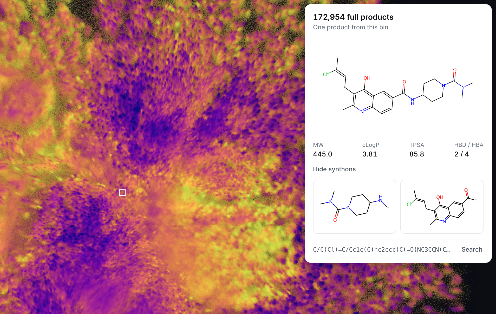

# synthonmap

[](https://synthonmap.mireklzicar.com/)
[](https://openreview.net/forum?id=qUoHw1xkIM)

**Stream coordinates into a high-resolution count histogram, then color the counts.**
This repository extracts the computational core of the SynthonMap product-density
experiment. It has no web server, UI, Deep Zoom, tile pyramid, or private database
requirement.

[](https://synthonmap.mireklzicar.com/)

*The [interactive demo](https://synthonmap.mireklzicar.com/) uses this rendering approach with a full visualization UI.*

The core accepts any batches of `(x, y)` coordinates. An optional worked example
uses the Freedom slice bundled with [synthonor](https://github.com/mireklzicar/synthonor):
assemble a small training set, fit a product UMAP, learn a reaction-aware coordinate
model from synthons, cache the synthon representations, and stream predictions
directly into a histogram. No molecule assembly is needed during that last pass.

## Install

```bash
git clone https://github.com/mireklzicar/synthonmap.git
cd synthonmap
python -m venv .venv
source .venv/bin/activate
pip install -e .                 # NumPy, Matplotlib, Pillow only
```

The core runs on CPU. `pip install -e '.[gpu]'` adds the optional PyTorch
accumulator; CUDA is only used when explicitly requested. Python 3.10+ is required.
These are source-install instructions, not a claim of a new PyPI release.

## Minimal histogram

```python
import numpy as np
from synthonmap import Histogram, display_ceiling, save_png

hist = Histogram(bounds=[[-10, -10], [10, 10]], shape=(2048, 2048))
for coordinates in your_coordinate_batches():   # each batch: (N, 2)
    hist.add(coordinates)

np.save("counts.npy", hist.counts)              # exact uint64 counts
save_png("density.png", hist.counts, ceiling=display_ceiling(hist.counts))
print(hist.receipt())                          # accepted/outside/nonfinite totals
```

For a complete runnable version with seeded synthetic coordinates:

```bash
python examples/coordinates.py --count 1000000 --size 2048
```

The example discovers bounds with a first pass, resets its RNG, and replays the
identical batches for the count pass. This retains the tails without saving all
coordinates. See [the algorithm and scaling notes](docs/algorithm.md).

## Worked Freedom example

```bash
pip install -e '.[example]'
python examples/freedom.py --out results/freedom
# Optional: same example with CUDA student training, inference and accumulation
python examples/freedom.py --device cuda --out results/freedom-cuda
```

Default settings: 3,000 UMAP training products, 400 validation products, 400 test
products, 1,500 student optimizer steps, and **1,000,000 sampled coordinates** on
a 2,048 × 2,048 grid. UMAP runs on CPU in this portable example. CUDA is optional;
its speed and floating-point results depend on the device and package versions.

The input is `synthonor`'s installed `synthon_space_1M.tsv` and matching reaction
table: **6,273 synthon rows, 42 reactions, 990,829 raw Cartesian combinations**.
They are loaded from the installed package, not copied from a licensed full-space
release or fetched from an internal service. The report records both file hashes.

1. Sample recipes proportional to each reaction's Cartesian capacity, assemble
   products, and remove invalid and duplicate canonical structures before splitting.
2. Fit UMAP to the training products' 2,048-bit Morgan fingerprints, with binary
   Jaccard/Tanimoto distance. Transform validation products into the fixed map.
3. Train a synthon encoder and reaction-aware coordinate head. Select the checkpoint
   by validation coordinate MSE; test products do not select it.
4. Cache one representation per synthon row. Recipe inference is cache lookup,
   an ordered concatenation of up to four synthons, reaction context, and a small MLP.
5. Make two seeded passes through the same sampled recipes: bounds, then counts.
   Only batch coordinates and the histogram need to remain in memory.
6. Save raw counts and ordinary PNGs at the original resolution, 8× lower resolution
   per axis, and 64× lower resolution per axis. Each image uses the same color scale.

To reuse the fitted model at a different draw count or resolution:

```bash
python examples/freedom.py --stage render --device cuda \
  --out results/freedom-cuda --draws 10000000 --size 4096
```

Rendering replaces count/image outputs in that directory, retaining the model.
Fitting refuses to overwrite an existing model. `--stage fit` runs only fitting.

Outputs include `model.pt`, `training-products.npz`, teacher/student coordinates,
`fit.json` (parameters, source hashes, versions, validation history and test recall),
`counts.npy`, coarsened counts/areas, three PNGs, and `render.json` (bounds, count
conservation, sampling seed, model hash and timings). Generated data are gitignored.
[The recorded worked run](docs/worked-example.md) reports the actual measured results.

## What the histogram means

The raster counts **sampled raw recipes mapped into learned coordinate space**.
Sampling uses replacement. Different recipes can yield the same molecule; some raw
recipes may fail assembly. They are not validated or deduplicated in the raster pass.
One million draws therefore does not mean one million unique molecules or exhaustive
coverage of this approximately one-million-combination slice.

The student is an approximation of UMAP, and two-dimensional proximity is an
approximation of chemical similarity. The example measures held-out exact
Morgan/Tanimoto nearest-neighbor recall against the training-product bank. That
score is not recall among all rendered points. This compact demonstration uses
coordinate distillation, not the larger experiment's full neighborhood-loss tuning
or its 250K-product training runs.

## Tests

```bash
pip install -e '.[test]'
pytest -q
```

Tests compare streamed counts with NumPy, check bounds and excluded-point accounting,
overflow, partial edge blocks, color-scale consistency, recipe enumeration/sampling,
and cached vs direct neural inference. Optional PyTorch tests run on CPU and CUDA
when available. CI also runs the dependency-light example.

## Relationship to the other code

This repository is the **standalone computational library and worked example**.
The separately developed local `DeepMedChem_Prod/synthonmap` checkout is the
visualization application: FastAPI, WebGL, molecule hover, and Deep Zoom. It has a
different Git history and is not a checkout of this repository. The original
research pipeline lives in `navigator-constellations-ui`; the library distills its
streamed accumulation, image-axis convention, count-preserving reduction,
log-density transfer, and cached reaction-aware model into independent modules.

`synthonor` is optional and supplies the example resources. Its search engine is
not required for rendering, nor are its approximate OR fingerprints substituted
for the example's assembled-product teacher fingerprints.

## Citation

[**Factorized Search and Cartography of Synthon-Based Chemical Spaces**](https://openreview.net/forum?id=qUoHw1xkIM) — Miroslav Lžičař, ICML 2026 GenBio Workshop.

```bibtex
@inproceedings{lzicar2026factorized,
  title     = {Factorized Search and Cartography of Synthon-Based Chemical Spaces},
  author    = {L{\v{z}}i{\v{c}}a{\v{r}}, Miroslav},
  booktitle = {ICML 2026 Workshop on Generative and Agentic AI for Biology (GenBio)},
  year      = {2026},
  url       = {https://openreview.net/forum?id=qUoHw1xkIM}
}
```
