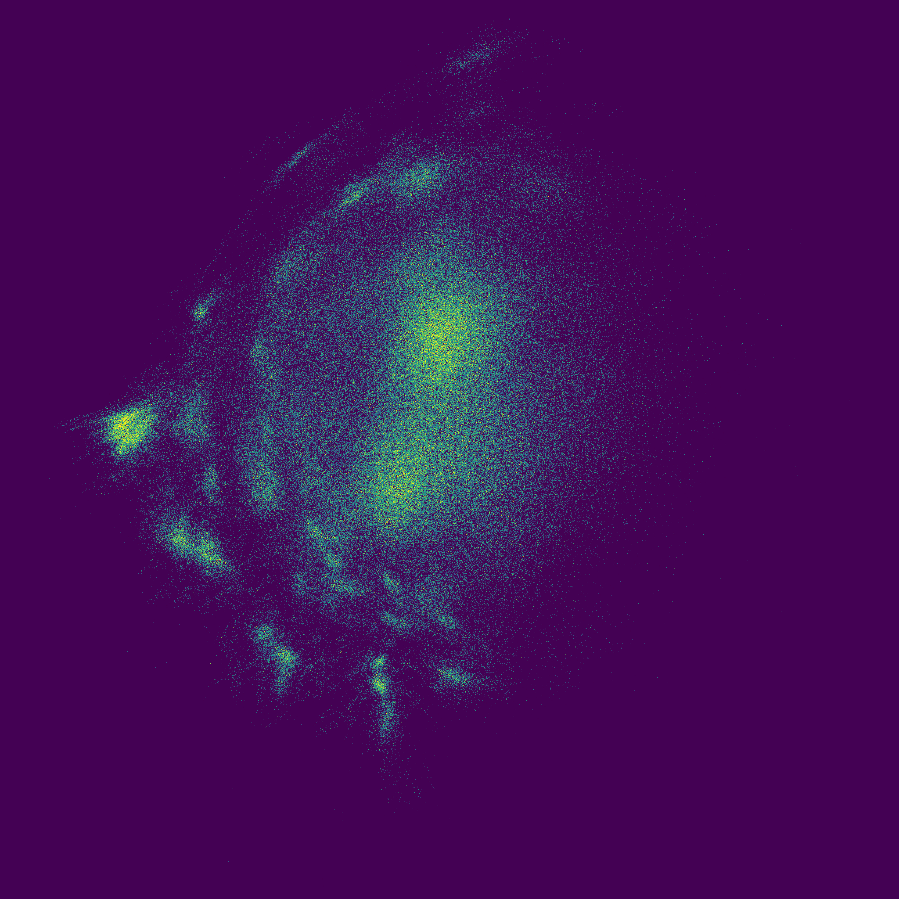

# Recorded Freedom example

This is the complete run behind the example image below, made on 6 November 2026:



```bash
pip install -e '.[example]'
python examples/freedom.py --device cuda --out results/freedom
```

The machine used an NVIDIA RTX 4090 for the small coordinate model and histogram;
UMAP and molecule preparation ran on CPU. This is the portable example's own fit,
not a reuse of any private production checkpoint.

| Item | Measured value |
|---|---:|
| Bundled synthon rows | 6,273 |
| Reactions | 42 |
| Raw recipe combinations | 990,829 |
| Distinct assembled training products | 3,000 |
| Validation / test products | 400 / 400 |
| Selected student step | 300 of 1,500 |
| Total preparation + teacher + student + audit | 42.87 s |
| Sampled coordinate draws | 1,000,000 |
| Grid | 2,048 × 2,048 |
| Accepted / outside / nonfinite draws | 1,000,000 / 0 / 0 |
| Bounds pass | 0.174 s |
| Inference + accumulation pass | 0.180 s |
| Student held-out recall@10 | 8.725% |
| True chemical top ten recovered within 100 map candidates | 38.625% |

The two streaming timings exclude model loading, fitting and PNG/file export.
The count pass includes host transfer of the final grid. They are observations on
this small example and machine, not a promise of billion-point throughput.

The recall bank contains 3,000 training products; queries are 400 canonical-product-
disjoint test molecules. Validation MSE, not test recall, selects the checkpoint.
The small student has substantial chemical-neighborhood distortion: **the image
demonstrates rendering and cached inference, not a high-recall retrieval method**.
Its quality is not directly comparable with the larger experiments' 50K-reference
audits. Larger training sets and chemical-neighborhood losses are separate work.

The first 3,801 distinct attempted recipes yielded 3,800 distinct valid canonical
products (one duplicate structure, no invalid products). This observation is for
the training/audit sample only. The million-draw raster has no chemistry validation
and samples with replacement; it does not exhaust all 990,829 combinations.

The raw records are [example-fit.json](example-fit.json) and
[example-render.json](example-render.json). They include source hashes, package
versions, the full validation history, and the checkpoint hash. Source hashes match
the data files distributed in the `synthonor==0.2.0` wheel. Seeded execution fixes
sampling, but package/backend differences can change UMAP and neural coordinates.

## Inspect the counts and resolution changes

```python
import numpy as np
from PIL import Image

for factor in (1, 8, 64):
    counts = np.load(f"results/freedom/counts-{factor}x.npy")
    areas = np.load(f"results/freedom/areas-{factor}x.npy")
    image = Image.open(f"results/freedom/density-{factor}x.png")
    print(factor, counts.shape, int(counts.sum()), image.size)
    assert int(counts.sum()) == 1_000_000
```

Expected count shapes: `(2048, 2048)`, `(256, 256)`, `(32, 32)`. Each sums to the
same million draws. Colors use counts divided by original-bin area and the single
recorded display ceiling of 10. Coarse pixels therefore represent a mean density;
they do not become bright merely because more original bins were summed.

The core also passed 13 tests locally, including CUDA/CPU agreement and cached vs
direct inference. The dependency-light synthetic example retained all one million
draws. CI exercises the core without optional chemistry/ML dependencies and a
separate CPU-PyTorch configuration.

A clean environment with only the core/test dependencies passed 10 tests (three
optional PyTorch checks skipped) and the synthetic example. A separate CPU-only
Freedom smoke run completed fitting, inference and count export. The distribution
wheel also built successfully.
